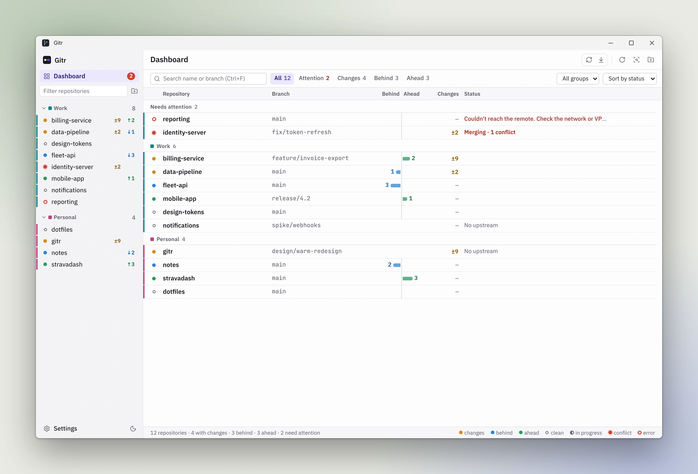
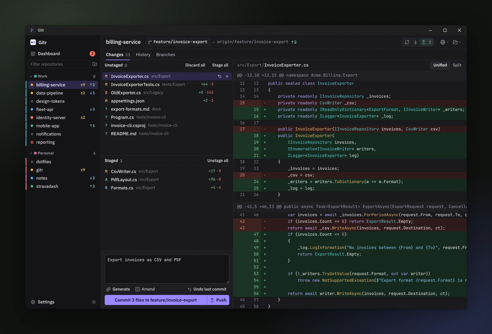
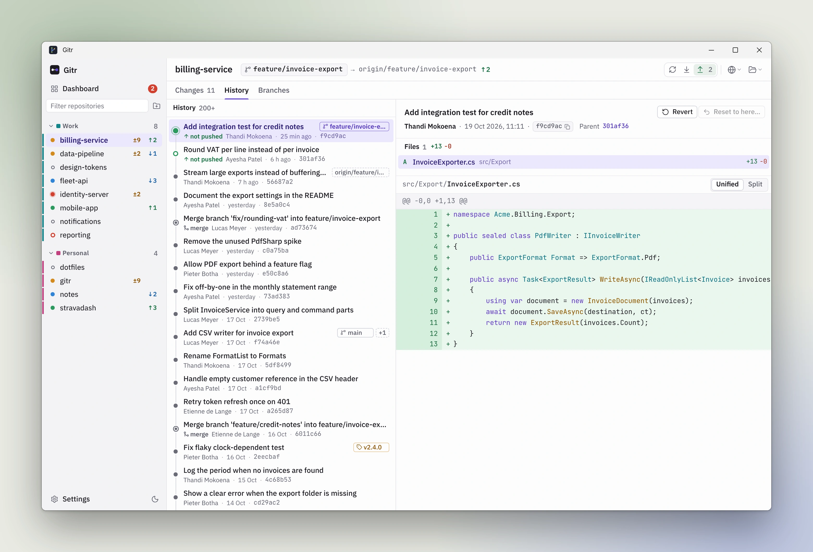

# Gitr

A fast, lightweight Windows Git client for people who work across many repositories at once.
One dashboard shows every repo's branch, ahead/behind and local changes, with fetch and pull for all
of them in one click. For the daily flow, each repo has a Changes tab to stage, diff and commit
(with messages generated by GitHub Copilot), a History tab to review, revert or reset commits, and a
Branches tab. Links open the repo, branch or a new pull request in Azure DevOps or GitHub.

Built with Tauri 2 (Rust) and a React + TypeScript UI.

## Screenshots

**Dashboard**: every repository with branch, ahead/behind, changes and status, as cards or a table.



**Changes**: stage, unstage and discard files, see the diff, write or generate the commit message.



**History**: commits on the current branch, what isn't pushed yet, and the files and diff of each commit.



## Install

Download `Gitr_<version>_x64-setup.exe` from the latest [GitHub Release](https://github.com/etiennedelange/gitr/releases/latest) and run it. It installs for your user only, with no admin rights.

The installer isn't code-signed yet, so the first time Windows SmartScreen says it "prevented an unrecognized app from starting". Choose **More info → Run anyway**. You only see this once: after that Gitr updates itself. When a new version is out, a bar at the top offers **Restart and update**, and **Settings → Updates** can check by hand.

## Features

- Workspace groups: point at root folders, repositories are discovered automatically
- Dashboard of every repo as compact cards, detailed cards or a table: branch, ahead/behind, changes, errors, last commit; filter and sort; new changes flash once
- Fetch all / pull all (fast-forward only) in parallel with per-repo progress
- Stage, unstage and discard files; unified or split diff view of the changed hunks or the whole file, with syntax colours for about 200 languages
- Commit, amend, push (sets upstream automatically)
- Commit messages generated by GitHub Copilot, streamed into the commit box
- Open repo, branch or a new pull request in Azure DevOps or GitHub
- Branches: checkout, create, delete
- History of the current branch: what changed in each commit, what isn't pushed yet; revert a commit, or reset the branch back to one (changes kept, with Undo)
- Auto-refresh on file changes
- Updates itself: a new version is offered in the app and installed with one click

## Requirements

- Git on `PATH`
- For commit message generation: [GitHub Copilot CLI](https://github.com/github/copilot-cli)
  (`winget install GitHub.Copilot`), run `copilot` once to sign in
- Development: Rust (stable), Node.js

## Development

```powershell
pnpm install
pnpm dev           # launches the app with hot reload
pnpm test          # UI tests
cargo test --workspace
pnpm build         # NSIS installer in target\release\bundle\nsis
pnpm screenshots   # every scene to tools/screenshots/out/; README shots to docs/screenshots/
```

Releases are built by GitHub Actions from a version tag on `main`; see
[docs/releasing.md](docs/releasing.md) for the branch, PR and release workflow.

The screenshots come from `tools/screenshots/`. The script runs the design preview
(`ui/src/preview/`) in headless Chromium, so it needs no Tauri build and works on any OS. It
renders every scene in light and dark to `tools/screenshots/out/` (not committed) and copies the
three this README shows to `docs/screenshots/`, as WebP.
Run `pnpm exec playwright install chromium` once before the first run. The dev container
(`.devcontainer/`) has everything installed, including the Tauri libraries `cargo test` needs.

### Developing on macOS

Gitr targets Windows, so on a Mac you work on the UI and the Rust crates in the dev container,
not on the installers.

- **Container config:** open the folder in VS Code and choose **Reopen in Container**. There is
  one config, `.devcontainer/devcontainer.json`, for every host. The cargo cache, Claude Code
  state, `node_modules` and `target` live in Docker named volumes, so nothing generated lands in
  the Mac folder and no bind mounts are involved.
- **Inside the container:** `pnpm test`, `cargo test --workspace`, `pnpm mock:web` (design
  preview, forwarded on port 5173) and `pnpm screenshots` all work. Keep the repo on the Mac's
  filesystem; Docker Desktop's VirtioFS makes `pnpm install` acceptable there. Colima or OrbStack
  are faster still.
- **Screenshots:** regenerate them in the container, so the
  rendering matches and the diffs show real changes only.
- **Commit signing:** commits are SSH-signed (`gpg.format ssh`, `commit.gpgsign true`,
  `user.signingkey key::ssh-ed25519 ...`), which `post-create.sh` sets inside the container. The
  key stays on the host: VS Code forwards your SSH agent into the container, so run `ssh-add -L`
  on the Mac and confirm it lists that key (with 1Password or Secretive, enable their agent and
  set `SSH_AUTH_SOCK`). If `git commit` in the container says "No private key found", the agent
  isn't forwarded.
- **Git outside the container:** a Mac terminal commit does not read the container's git config.
  Set the same three options in your Mac global git config if you commit from there.

## Layout

| Path | Purpose |
|---|---|
| `crates/gitr-core` | Repo discovery, git CLI runner, status/diff/branch parsing, diff syntax colours, operations |
| `crates/gitr-remote` | ADO / GitHub remote URL parsing and web link building |
| `crates/gitr-ai` | Copilot SDK integration and prompt building |
| `src-tauri` | Tauri commands, app state, config, file watcher |
| `ui` | React UI |

Configuration lives in `%APPDATA%\gitr\config.toml`.

## Keyboard shortcuts

| Keys | Action |
|---|---|
| Ctrl+D | Dashboard |
| Ctrl+Shift+F / Ctrl+Shift+P | Fetch all / pull all |
| Ctrl+, | Settings |
| ↑ ↓, Space, Delete | Select, stage/unstage, discard file |
| Ctrl+G | Generate commit message |
| Ctrl+Enter / Ctrl+Shift+Enter | Commit / commit and push |
| Ctrl+O | Open branch in browser |
| Ctrl+Tab / Ctrl+Shift+Tab | Next / previous tab (Changes, History, Branches) |
| ↑ ↓, Enter, ← | History: select a commit, go to its files, back to the commits |

## Further reading

- [Third-party notices](THIRD_PARTY_NOTICES.txt): the licences of everything that ships in the app. Regenerate with `pnpm notices` after changing dependencies.

## License

MIT. See [LICENSE](LICENSE).
